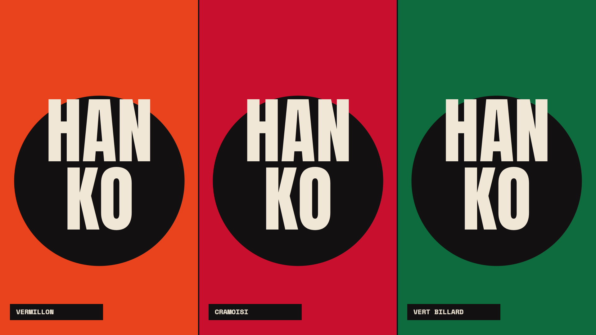

# Hanko · Extras — Omarchy

Installer, shell components and shared assets for the **Hanko** theme for [Omarchy](https://omarchy.org) 4: a minimal, editorial theme in three variants.



| Variant | Repository |
|---|---|
| Vermillon | [omarchy-hanko-vermillon-theme](https://github.com/MoozyDev/omarchy-hanko-vermillon-theme) |
| Cramoisi | [omarchy-hanko-cramoisi-theme](https://github.com/MoozyDev/omarchy-hanko-cramoisi-theme) |
| Vert billard | [omarchy-hanko-vert-billard-theme](https://github.com/MoozyDev/omarchy-hanko-vert-billard-theme) |

## Install — pick one level

**Everything** (colours, wallpapers, icons, bar, menu, desktop widgets, screensaver, lock screen, boot screen):

```
curl -fsSL https://raw.githubusercontent.com/MoozyDev/omarchy-hanko-extras/main/install.sh | bash -s vermillon totale
```

**Essentials** (colours, wallpapers, folder and app icons, Anton font, ASCII logo, fastfetch — no plugins, no sudo):

```
curl -fsSL https://raw.githubusercontent.com/MoozyDev/omarchy-hanko-extras/main/install.sh | bash -s vermillon essentiel
```

**Theme only** (colours, wallpapers, folder icons):

```
curl -fsSL https://raw.githubusercontent.com/MoozyDev/omarchy-hanko-extras/main/install.sh | bash -s vermillon theme
```

Replace `vermillon` with `cramoisi` or `vert-billard`. Run it as your user inside your Omarchy session (or over SSH: the session is found automatically). The full install asks for `sudo` for the lock and boot screens only.

**Step-by-step guide, every command explained (French): [docs/TUTORIEL.md](docs/TUTORIEL.md).**

What it sets up:

| Part | How |
|---|---|
| Theme (colours, wallpapers, icons) | `omarchy theme install` of the variant repo |
| Anton font, app / web-app icons, ASCII logo, fastfetch | copied, your previous files kept in `~/.local/share/hanko/backup` |
| Bar that grows on hover | your clone of Omarchy's bar (`omarchy plugin clone omarchy.bar`) + a small marked patch |
| Hanko bar icons | a hook in Omarchy's `BarIconButton.qml` mapping each icon character to your SVG; re-applied by a pacman hook |
| Wide and low menu (choice B) | your clone of Omarchy's menu + a small marked patch |
| Screensaver (6 animations) | shell plugin `hanko.screensaver`, replaces Omarchy's ASCII one |
| Lock screen (clock, field position, no blur) | a hook in Omarchy's `LockView.qml` that loads `~/.config/omarchy/lock-skin/Skin.qml`; re-applied by a pacman hook after each Omarchy update |

The variant repo still installs on its own (colours and wallpapers only):

```
omarchy theme install https://github.com/MoozyDev/omarchy-hanko-vermillon-theme
```

## The `hanko` command

```
hanko doctor                                  state of every part
hanko theme <variant>                         switch variant
hanko bar on|off · hanko menu on|off          bar and menu patches
hanko icons install|on|off|uninstall          Hanko SVG icons in the bar (sudo once)
hanko widgets on|off                          desktop widgets + live HANKO wallpaper
hanko boot on|off                             disk-unlock screen
hanko screensaver on|off|test [animation]     eclipse orbite onde balayage defilement phases
hanko lock on|off|edit|status|uninstall       lock screen skin (off = Omarchy's default look)
hanko update · hanko uninstall
```

Screensaver delay: `omarchy bar set hanko.screensaver delay 300` (seconds, 0 = never).

Why it is built this way (what Omarchy lets a theme do, and the lock screen): [docs/architecture.md](docs/architecture.md). What is done versus the mockups: [docs/ETAT.md](docs/ETAT.md).

## What is in this repo
- `install.sh`, `bin/hanko` — installer and command.
- `bar/`, `menu/`, `lock/` — patches (all marked `HANKO-*`, all reversible) and the lock skin.
- `plugins/hanko.screensaver/` — the screensaver.
- `fonts/` — Anton (SIL OFL 1.1). The system font is `ttf-space-mono-nerd` from the Arch repos.
- `logo/` — Moozy logo, V1 and V2, SVG + PNG from 14 to 1000 px, usage guide.
- `icons/bar/` — 45 monochrome 24×24 SVG bar icons + `correspondance.md` (icon → Omarchy widget).
- `branding/` — `about.txt`, `screensaver.txt`.
- `fastfetch/` — `config.jsonc`.
- `sounds/` — `notification.wav`, `verrouillage.wav` (lock).
- `looknfeel.md` — window borders, gaps, blur, animations, cursor.
- `specs/` — one spec per component (bar, lock screen, desktop widgets, per-screen wallpaper, screensaver, OSD, launcher, notifications, Twitch live badge) + interactive mockups.
- `presentation/` — banners, comparison image, avatars.

## Status
**1.1.0.** Done: installer (3 levels), bar on hover, wide menu, desktop widgets, live HANKO wallpaper, lock screen skin, boot screen, 6 of the 11 screensaver animations. Not yet: Marée, Vinyle, Fréquence, Trame, Phases 6d-3; window look'n'feel; OSD and notification styling.

---

**En français** — Une seule commande installe tout : le thème, les extras, la barre qui grandit au survol, le menu large, l'écran de veille et l'écran de verrouillage Hanko. `hanko doctor` montre l'état de chaque élément, `hanko uninstall` remet tout comme avant. Pourquoi c'est construit ainsi : `docs/architecture.md`.
